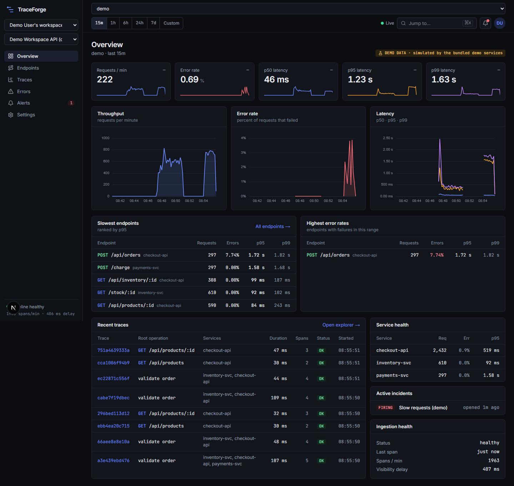
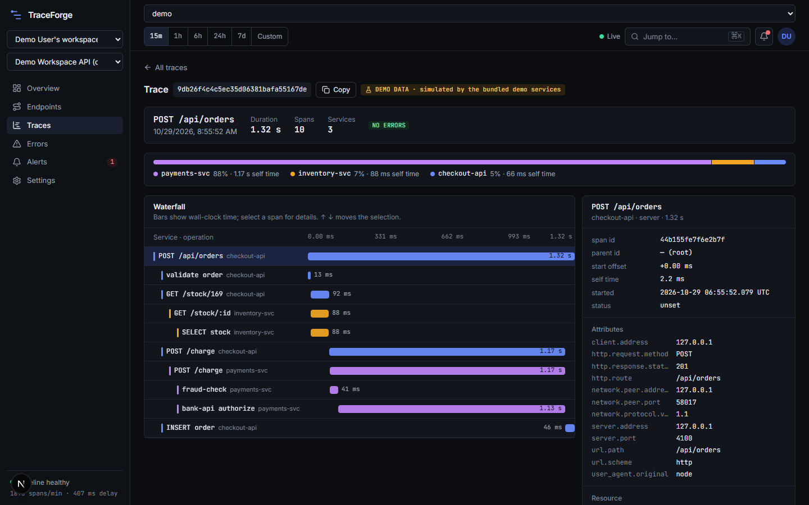
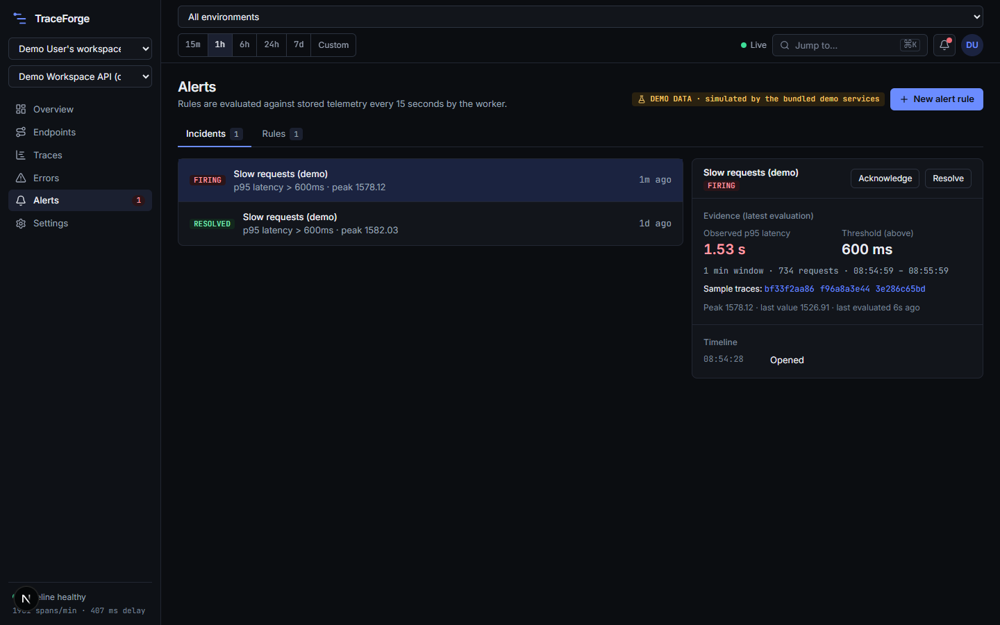
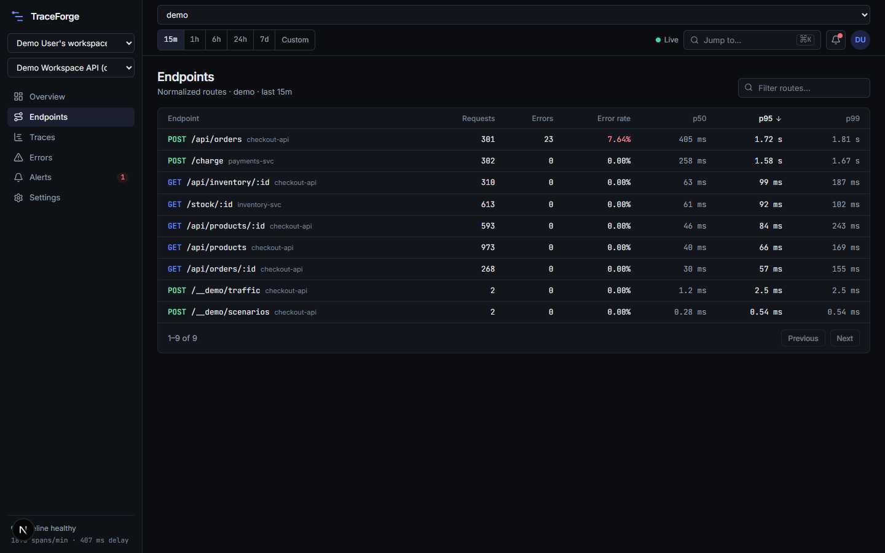
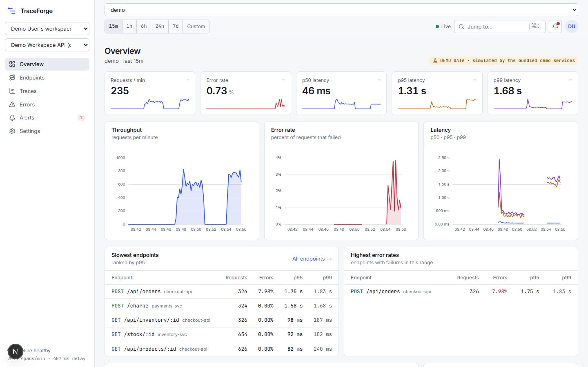
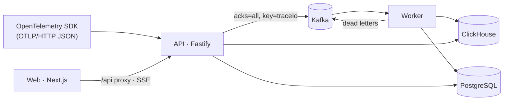

# TraceForge

API observability and distributed tracing for Node.js services. Instrument an app with any OpenTelemetry SDK, point it at
TraceForge, and get throughput, error rate and latency percentiles per endpoint, searchable distributed traces with a
waterfall, grouped errors, and alert rules with an incident workflow, backed by a real Kafka → ClickHouse pipeline.



|                                                                                       |                                                                            |
| ------------------------------------------------------------------------------------- | -------------------------------------------------------------------------- |
|                                         |                |
| Distributed trace across three services; 88% of the time is `payments-svc → bank-api` | An incident with the evidence that triggered it, sample traces and history |
|                                           |                         |

All screenshots are of the running application with telemetry from the bundled demo services (flagged **DEMO DATA** in the
UI). Design sources (Claude design canvas boards for the shell, overview, endpoints, trace waterfall, alerts and design
tokens) are in [`docs/design`](docs/design).

## How it works



1. **Ingest** – `POST /v1/traces` authenticates the project API key, validates, rate-limits, redacts sensitive attributes and
   publishes to Kafka. A `200` means _durably in Kafka_; a Kafka problem is a `503` + `Retry-After`, never a silent drop.
2. **Process** – the worker consumes in bounded batches, normalizes (routes, error fingerprints), writes ClickHouse
   idempotently, retries transient failures with jittered backoff, isolates poison messages into a dead-letter topic, and
   commits offsets only after persistence.
3. **Query** – the API answers dashboard queries from ClickHouse (telemetry) and PostgreSQL (accounts, keys, rules, incidents);
   the UI gets aggregate live updates over SSE.
4. **Alert** – the worker evaluates enabled rules every 15 s and opens, refreshes, acknowledges and auto-resolves incidents.

Details: [architecture](docs/architecture.md) · [event contracts](docs/event-contracts.md) · [data model](docs/data-model.md) ·
[operations](docs/operations.md) · [security](docs/security.md) · [local development](docs/local-development.md) ·
[decisions](docs/decisions) · [implementation status](docs/implementation-status.md).

## Features

- **Overview** – requests/min, error rate, p50/p95/p99 with period-over-period deltas; throughput, error-rate and latency charts
  (gaps are shown as gaps, never as zeros or interpolation); slowest endpoints; highest error rates; service health; recent
  traces; active incidents; ingestion health with measured visibility delay.
- **Endpoints** – searchable, sortable, paginated table of normalized routes; per-endpoint investigation page with time series
  and slowest/failed traces.
- **Traces** – cursor-paginated search (status, route, minimum duration), trace-ID lookup, and a **waterfall** with span
  hierarchy, per-service self-time breakdown, error markers, keyboard navigation, a virtualized row list, and explicit
  warnings for orphan spans, multiple roots, duplicates, cycles and probable clock skew.
- **Errors** – groups by a stable fingerprint, with occurrences over time, endpoints involved, stack trace and related traces.
- **Alerts** – error rate, p95/p99 latency and request rate rules with scope (environment, service, method, route), minimum
  sample size, real state transitions (firing → acknowledged → resolved/auto-resolved), duplicate suppression, evidence and a
  timeline.
- **Settings** – API keys (shown once, rotate, revoke), OpenTelemetry setup snippets, retention info, rename and typed-confirmation
  delete; **demo controls** (traffic and fault injection) on demo projects.
- **App shell** – workspace/project/environment selectors, global time range (presets or custom) persisted in the URL, ⌘K quick
  navigation, live indicator, incident bell, light/dark themes, responsive sidebar, loading/empty/error states with retry and
  request ids.
- **Demo** – three OpenTelemetry-instrumented services (`checkout-api` → `inventory-svc`, `payments-svc`) with seeded traffic
  and five injectable faults (`slow-db`, `slow-downstream`, `intermittent-errors`, `downstream-timeout`, `high-volume`).

## Stack

TypeScript (strict) everywhere · Node.js 22 · pnpm workspaces · **Fastify 5** · **Next.js 16** (App Router, React 19) · Tailwind
CSS 4 · TanStack Query · Apache ECharts · react-hook-form + Zod 4 · **PostgreSQL 17** with Drizzle ORM · **Apache Kafka 3.9**
(KRaft) with KafkaJS · **ClickHouse 25.3** · OpenTelemetry JS SDK · pino · Vitest · Playwright · ESLint + Prettier · GitHub Actions.

## Quick start

Prerequisites: Node.js ≥ 22.12, pnpm 10 (`corepack enable`), Docker with Compose v2, free ports 3000, 4000, 4001, 4100–4102,
5433 (Postgres), 8123 (ClickHouse), 9092 (Kafka).

```bash
pnpm install
cp .env.example .env     # development defaults matching docker-compose.yml
pnpm infra:up            # Postgres, Kafka (+ topic creation), ClickHouse; waits until healthy
pnpm db:migrate          # Postgres + ClickHouse migrations (idempotent, works on an empty database)
pnpm dev                 # api :4000 · worker :4001 · web :3000
```

In a second terminal, start the demo:

```bash
pnpm demo:setup          # creates the demo user, a demo project and an API key (written to .env.demo)
pnpm dev:demo            # three instrumented services
pnpm demo:traffic start 8
```

Open <http://localhost:3000/login> and sign in as `demo@traceforge.local` (the development password is in
[`scripts/demo-setup.ts`](scripts/demo-setup.ts); override with `DEMO_USER_PASSWORD`). You can also register your own account.

### Demo walkthrough

1. **Overview** shows live traffic from the demo services (header: _Live_, project badge: _DEMO DATA_).
2. **Settings → Demo controls** → switch on `slow-downstream` and `intermittent-errors`. Within a minute p95 and the error rate rise on the overview.
3. **Endpoints** → `POST /api/orders` shows elevated p95; open it for its time series and slowest traces.
4. Open the slowest trace. The **waterfall** shows `payments-svc → bank-api authorize` dominating; select the span for attributes and timing.
5. **Errors** shows the `DeadlockError` group; open an occurrence's trace.
6. **Alerts → New alert rule**, e.g. _p95 latency above 600 ms over 1 minute_. The incident opens within ~20 s with its evidence; acknowledge it, turn the fault off, and watch it auto-resolve after two healthy evaluations.

Without the demo, create a project and API key in the UI and configure any OpenTelemetry SDK:

```bash
OTEL_EXPORTER_OTLP_TRACES_ENDPOINT=http://localhost:4000/v1/traces
OTEL_EXPORTER_OTLP_TRACES_PROTOCOL=http/json
OTEL_EXPORTER_OTLP_HEADERS=authorization=Bearer tf_live_…
```

## Configuration

Everything is configured through environment variables, validated at startup (a bad value fails fast, naming the variable but
never printing secrets). [`.env.example`](.env.example) documents every variable. Highlights: `DATABASE_URL`, `KAFKA_BROKERS`,
`CLICKHOUSE_*`, `WEB_ORIGINS`, `INGEST_*` limits, `WORKER_*` batching/retry/concurrency, `ALERT_EVALUATION_INTERVAL_MS`,
`SELF_TELEMETRY_*`, `DEMO_MODE`. With `NODE_ENV=production` the services refuse the development credentials.

## Testing

| Command                                              | Scope                                                                                                                                                                                                                                                                                                    | Result at the time of writing             |
| ---------------------------------------------------- | -------------------------------------------------------------------------------------------------------------------------------------------------------------------------------------------------------------------------------------------------------------------------------------------------------- | ----------------------------------------- |
| `pnpm test`                                          | 108 unit tests: redaction, OTLP conversion, route normalization, fingerprints, row derivation, bucketing, alert state machine, retry/backoff, trace layout, pipeline poison isolation, security primitives                                                                                               | pass                                      |
| `pnpm test:integration`                              | 41 tests against real Postgres, Kafka, ClickHouse in isolated databases/topics: analytics, idempotency, project isolation, the Kafka→ClickHouse pipeline (DLQ, restart, ClickHouse outage), API auth/roles/CSRF/keys/ingest limits/gzip/rate limit/Kafka-down, alert evaluator lifecycle and concurrency | pass                                      |
| `pnpm test:e2e`                                      | 3 Playwright journeys: sign-up → API key → ingest → analytics → trace → span selection → alert rule → incident acknowledge/resolve → cross-user isolation; retryable error state; sign-out/login                                                                                                         | pass (also against the production builds) |
| `pnpm smoke`                                         | 18 live checks against a running stack                                                                                                                                                                                                                                                                   | pass                                      |
| `pnpm lint` · `pnpm typecheck` · `pnpm format:check` | static analysis, strict TypeScript, formatting                                                                                                                                                                                                                                                           | pass                                      |

`pnpm build` produces production bundles; the built API, worker and Next.js server were run and exercised with the smoke and
e2e suites. The failure scenarios (Kafka down, ClickHouse down, worker restart, duplicates, malformed telemetry, bad keys, rate
limiting, partial failures) and where each is tested are tabulated in [operations.md](docs/operations.md#failure-modes);
the two cases that are **not** covered by an automated test (real query timeout, Postgres outage) are marked there.

## API

REST under `/v1`, one error envelope (`{ "error": { "code", "message", "requestId", "details?" } }`), Zod-validated inputs.
The OpenAPI 3.1 document is served at `GET /openapi.json` and generated from the same schemas the handlers use. Main groups:
`/v1/traces` (ingest) · `/v1/auth/*`, `/v1/me` · `/v1/workspaces/*`, `/v1/projects/:id` · `/v1/projects/:id/api-keys` ·
`overview`, `endpoints`, `endpoints/detail`, `services`, `dimensions`, `ingestion-health`, `traces`, `traces/:id`, `errors`,
`errors/:fingerprint` · `alert-rules`, `incidents` (+ `acknowledge`, `resolve`) · `stream` (SSE).

## Benchmark

Reproduce with `pnpm loadtest --rate 1000 --duration 30 --concurrency 16 --spans-per-request 20` (raw results are saved in
[`bench/results`](bench/results)). The generator is open-loop (requests on a clock), polls a marker trace every second from
the moment it is accepted to measure end-to-end visibility, and reads CPU/RSS/lag from the services' `/metrics`.

**Environment:** Windows 11, Intel i7-11800H (8 cores / 16 threads), 32 GiB. **Everything shares this one machine**: the load
generator, the _production builds_ of the API and worker, the Next.js server, and Postgres/Kafka/ClickHouse containers (Docker
engine inside WSL2). Single Kafka broker, single ClickHouse node, 6 partitions, one worker with concurrency 1, default limits
(2,000 spans/s per project). Duration 30 s per run; one run per configuration; no warm-up exclusion; times in ms.

|                                                        | Run A                            | Run B                                          |
| ------------------------------------------------------ | -------------------------------- | ---------------------------------------------- |
| Load                                                   | 1,000 spans/s · 20 spans/request | 1,900 spans/s · 50 spans/request · +300 B/span |
| Achieved / skipped by generator                        | 1,000 spans/s / 0                | 1,900 spans/s / 0                              |
| Responses                                              | 1,501 × `200`                    | 1,141 × `200`                                  |
| Ingest response latency p50 / p95 / p99 / max          | 7.1 / 9.7 / 11.7 / 36.0          | 8.2 / 11.3 / 14.2 / 38.9                       |
| Time until a trace is queryable p50 / p95 / p99 (n=29) | 485 / 876 / 879                  | 487 / 790 / 923                                |
| Drained after load ended                               | 0.73 s                           | 0.79 s                                         |
| Spans accepted → stored and counted                    | 30,020 → 30,020                  | 57,050 → 57,050                                |
| Consumer lag at end of load → after drain              | 170 → 0                          | 331 → 0                                        |
| Batch failures / dead letters                          | 0 / 0                            | 0 / 0                                          |
| API / worker CPU (seconds consumed)                    | 9.3 / 6.3                        | 8.6 / 6.3                                      |
| API / worker RSS                                       | 130 / 125 MiB                    | 138 / 134 MiB                                  |

Dashboard queries, measured warm and sequentially after each run (20 requests each; ≈ 211,000 request rows in the 1 h window,
read with `FINAL`), p50 / p95 / p99 in ms:

| Query                           | Run A           | Run B           |
| ------------------------------- | --------------- | --------------- |
| overview (parallel sub-queries) | 278 / 342 / 352 | 304 / 346 / 384 |
| endpoints                       | 47 / 57 / 57    | 63 / 69 / 70    |
| traces (25, no filter)          | 204 / 274 / 284 | 222 / 277 / 338 |
| errors                          | 49 / 59 / 61    | 46 / 49 / 50    |

**Limitations of these numbers:** one machine with contended CPU, one local broker and node, a short run, a single
repetition, and synthetic uniform spans. The ceiling above 1,900 spans/s was **not** measured (the default per-project rate
limit is 2,000 spans/s); the rate limiter is an intended bound, not a measured capacity. The _consumer-lag_ gauge is sampled
by the worker every 10 s, so "at end of load" is an approximate value.

## Security notes

scrypt password hashing; server-side sessions storing only token hashes; API keys shown once and stored as SHA-256;
`HttpOnly`/`SameSite` cookies plus Origin checks for CSRF; strict workspace isolation (404 across workspaces, roles enforced);
bound-parameter queries only; request/decompressed-size, span-count and rate limits; sensitive attributes, URL queries and
SQL literals removed **before** data reaches Kafka; no secrets in the repository; production mode rejects development
credentials; `pnpm audit --prod` clean at the time of writing. See [security.md](docs/security.md) for the model, including gaps.

## Known limitations

- **OTLP/HTTP JSON only.** Protobuf and gRPC are not supported (`415`); a Collector can translate.
- Local-account authentication only (no SSO, email verification, password reset or MFA). Use an IdP for public deployments.
- Rate limiting and API-key caching are per process; a revoked key may work for up to 30 s on other instances.
- Fixed 14-day retention for everyone; deleting a project does not purge stored telemetry.
- Traces only: no metrics or logs ingestion, no notification channels (alerts are visible in the UI only; nothing is sent
  externally).
- Single-broker/single-node local infrastructure; no replication, no HA, no multi-region. Not load-tested beyond the runs above.
- Query-time aggregation with `FINAL`; trace search scans a project's spans in the time window. Fine at this scale; see
  [ADR 0005](docs/decisions/0005-trace-and-aggregate-query-patterns.md) for the next steps.
- Only Node.js services are demonstrated, although any OTLP/JSON exporter works.
- UI verified in Microsoft Edge (Chromium) only: desktop width in dark and light themes, plus the trace page at a 390 px phone width. No other browsers or pages were checked on mobile, and no automated accessibility audit (axe/Lighthouse) was run; accessibility work consists of semantic markup, labelled controls, keyboard-operable menus/tabs/dialogs/waterfall, visible focus rings, reduced-motion support and contrast-aware tokens.
- Dependency version choices (TypeScript 5.9, ESLint 9, Vitest 4) deliberately stay behind the newest majors for tooling
  compatibility.

## Repository layout

```
apps/        api · worker · web · demo-service
packages/    contracts · domain · storage · messaging · config · logger · telemetry
infrastructure/  clickhouse migrations · kafka topic creation
scripts/     migrate · demo-setup · demo-traffic · smoke · loadtest · screenshots
e2e/ tests/  Playwright journeys · shared integration-test helpers
docs/        architecture · contracts · data model · operations · security · ADRs · design sources · screenshots
```
