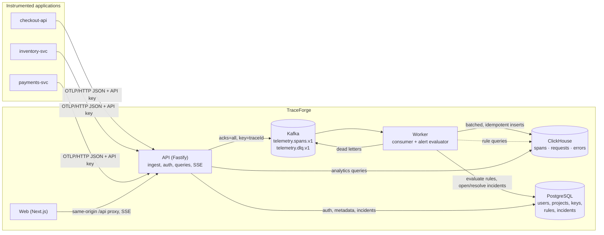

# Architecture

TraceForge is a **modular monolith plus one pipeline worker**: a Fastify API, a Kafka consumer/alert worker and a
Next.js dashboard, sharing typed packages. There is no service mesh and no microservice sprawl; every moving part below
exists because a requirement needs it (see the ADRs in [`decisions/`](decisions)).

## Service boundaries and data ownership

| Component           | Owns                                                                                                               | Talks to                                                        |
| ------------------- | ------------------------------------------------------------------------------------------------------------------ | --------------------------------------------------------------- |
| `apps/api`          | HTTP surface: ingestion, auth/sessions, project and key management, queries, SSE                                   | Postgres, ClickHouse (read), Kafka (produce)                    |
| `apps/worker`       | Telemetry persistence and alert evaluation                                                                         | Kafka (consume + DLQ), ClickHouse (write), Postgres (incidents) |
| `apps/web`          | UI only. No secrets, no direct database or Kafka access                                                            | The API through a same-origin `/api` proxy                      |
| `apps/demo-service` | Three instrumented demo services with fault injection (demo only)                                                  | Sends OTLP to the API like any customer                         |
| PostgreSQL          | Transactional metadata (users, sessions, workspaces, projects, API key hashes, rules, incidents and their history) |                                                                 |
| ClickHouse          | Telemetry: `spans`, `requests`, `errors`                                                                           |                                                                 |
| Kafka               | The durable buffer between acceptance and persistence                                                              |                                                                 |

Shared packages (all TypeScript, consumed as source):

- `contracts` – Zod schemas and DTOs shared by API, worker and web (event schema, OTLP input schema, query validation, error envelope).
- `domain` – pure, heavily unit-tested logic: OTLP→event conversion, redaction, route normalization, error fingerprinting, time bucketing, alert state machine, trace waterfall layout, retry/backoff.
- `storage` – Drizzle schema/repositories for Postgres and parameterized ClickHouse queries.
- `messaging` – KafkaJS producer/admin wrappers. `config`, `logger`, `telemetry` – validated env loading, redacting pino logger, OpenTelemetry bootstrap.

Dependencies point one way: `apps → storage/messaging → domain → contracts`. There are no cycles.

## Ingestion flow and its acknowledgement guarantee

1. `POST /v1/traces` (OTLP/HTTP **JSON**). The API key is authenticated in `onRequest`, _before_ the body is parsed.
2. Optional gzip is inflated under the body limit (zip-bomb safe), then validated against the OTLP Zod schema.
3. Per-project token-bucket rate limit (cost = span count); concurrency limit on in-flight publishes.
4. Spans are converted to `SpanEventV1`: IDs validated, timestamps range-checked, **sensitive attributes dropped, URL queries stripped, SQL literals masked, sizes capped** (see [security.md](security.md)). Invalid spans are counted and reported via OTLP `partialSuccess`; they do not fail the batch.
5. Events are published to `telemetry.spans.v1` keyed by trace ID with an **idempotent producer and `acks=all`**.
6. Only then does the API respond `200`.

**What a 2xx means:** every accepted span is in Kafka on all in-sync replicas. It does _not_ mean the span is queryable yet. If Kafka cannot confirm, the client gets `503` + `Retry-After` and nothing is acknowledged; there is no in-memory buffer that could lose accepted data. Persistence to ClickHouse is asynchronous and typically completes in under a second (measured: see README).

## Processing flow (worker)

Kafka consumer (manual offset commits) → per-chunk pipeline:

1. Decode JSON → validate `SpanEventV1`. Failures go to the **DLQ** (`invalid_json`, `invalid_schema`) and never block the partition.
2. `deriveRows`: span row, request row (HTTP entry spans), error row (with fingerprint).
3. One `INSERT` per table (JSONEachRow), in parallel. Transient failures (connection errors, timeouts, `TOO_MANY_PARTS`, …) retry with exponential backoff and full jitter, bounded by `WORKER_MAX_RETRIES`.
4. A **data** error (ClickHouse says the rows themselves are bad) is isolated by recursive bisection, so one poison message goes to the DLQ (`processing_failed`) while the rest of the chunk persists.
5. DLQ messages are published (acks=all) _before_ the chunk's offsets are committed. If the store is still unavailable after retries the chunk throws, offsets are **not** committed, the consumer is rebuilt with capped backoff, and processing resumes from the last committed offset when the store returns. Nothing is lost and nothing is dead-lettered because of an outage.

Delivery is **at-least-once**; correctness comes from idempotent storage, not from exactly-once claims (ADR 0004).

## Query patterns

- All analytics reads are parameterized (`{name:Type}`); sort columns come from fixed maps, never user input.
- `requests` (one row per HTTP entry span, ordered time-first) backs throughput, error rate, percentiles, endpoint tables and alert evaluation. It is read with `FINAL` so unmerged duplicates never inflate counts.
- `spans` (ordered by trace) backs trace detail (`FINAL`, single-trace prefix scan) and trace search. Trace search aggregates with `uniqExact(span_id)`, which is duplicate-safe without `FINAL`, and uses keyset pagination on `(start, trace_id)`.
- `errors` (ordered by fingerprint) backs error groups.
- Time series are bucketed with epoch-aligned integer arithmetic and gaps are filled in the application: counts as zero, latency as _no data_, never interpolated.
- Every query is project-scoped, time-bounded, `LIMIT`ed and subject to `max_execution_time` (default 10 s → `QUERY_TIMEOUT`, HTTP 504).

## Live updates

`GET /v1/projects/:id/stream` (SSE, cookie-authenticated, ≤5 connections per user). A `LiveHub` computes **one** small aggregate snapshot per project every 5 s regardless of viewer count (requests/min, error rate, p95, active incidents, ingestion health) – never individual spans. The browser refreshes visible queries only when new telemetry arrived, reconnects with exponential backoff, and degrades to polling.

## Health model

| Endpoint             | Question answered                                      | Depends on                                                     |
| -------------------- | ------------------------------------------------------ | -------------------------------------------------------------- |
| `/healthz`           | Is the process alive?                                  | nothing (never fails because of a dependency)                  |
| `/readyz` (API)      | Can it take traffic? `ok` / `degraded` / `unavailable` | Postgres required; Kafka and ClickHouse reported as `degraded` |
| `/readyz` (worker)   | Is the pipeline processing?                            | consumer running, ClickHouse reachable, pipeline not `stalled` |
| `/pipeline` (worker) | Why not? last success/failure, error, counts           | –                                                              |

A transient outage therefore shows as `degraded`/`degraded pipeline` and recovers by itself; only a _sustained_ failure (default 5 min) becomes `stalled` and fails worker readiness.

## Failure behaviour

See [operations.md](operations.md#failure-modes) for the full table (symptom, behaviour, recovery, test).
