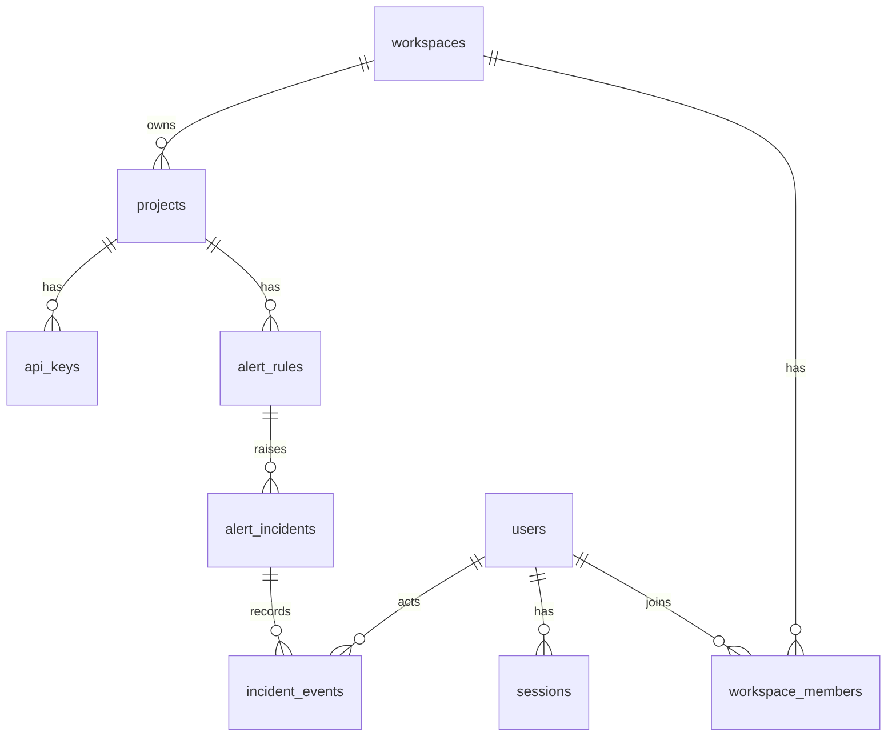

# Data model

## PostgreSQL (transactional metadata)

Defined in [`packages/storage/src/pg/schema.ts`](../packages/storage/src/pg/schema.ts), migrated with Drizzle
(`packages/storage/drizzle/*.sql`, applied by `pnpm db:migrate`).

| Table                             | Notes                                                                                                                                                                                                                                    |
| --------------------------------- | ---------------------------------------------------------------------------------------------------------------------------------------------------------------------------------------------------------------------------------------- |
| `users`                           | Email stored lowercased (unique). `password_hash` is `scrypt$N$r$p$salt$hash`.                                                                                                                                                           |
| `sessions`                        | Only a **SHA-256 of the cookie token** is stored; expiry indexed.                                                                                                                                                                        |
| `workspaces`, `workspace_members` | Roles `owner · admin · member · viewer`; composite PK `(workspace_id, user_id)`.                                                                                                                                                         |
| `projects`                        | Unique slug per workspace; `is_demo` flags simulated data; soft delete (`deleted_at`).                                                                                                                                                   |
| `api_keys`                        | `key_hash` (SHA-256, unique), display `prefix`, `last_used_at`, `revoked_at`. The raw key is never stored.                                                                                                                               |
| `alert_rules`                     | metric, operator, threshold, window, `min_requests`, optional environment/service/method/route scope.                                                                                                                                    |
| `alert_incidents`                 | status `firing → acknowledged → resolved`, peak/last value, `recovery_streak`, JSON `evidence`, snapshot of rule name/severity. **Partial unique index `(rule_id) WHERE status <> 'resolved'`** guarantees one active incident per rule. |
| `incident_events`                 | Audit trail: `opened`, `acknowledged`, `resolved`, `auto_resolved` with actor and time.                                                                                                                                                  |

Every workspace-owned resource is reached through `getProjectAccess(projectId, userId)`, which joins project →
workspace membership. Non-members get `404` (not `403`) so project existence is not disclosed.

## ClickHouse (telemetry)

Migrations: [`infrastructure/clickhouse/migrations`](../infrastructure/clickhouse/migrations), tracked in
`schema_migrations`. All three tables are `ReplacingMergeTree(ingested_at)`, partitioned by day, with a 14-day TTL.

| Table      | One row per              | `ORDER BY` (also the de-duplication identity)                                                     | Serves                                             |
| ---------- | ------------------------ | ------------------------------------------------------------------------------------------------- | -------------------------------------------------- |
| `spans`    | span                     | `(project_id, trace_id, span_id)`                                                                 | trace detail, trace search                         |
| `requests` | HTTP entry (server) span | `(project_id, toStartOfHour(start_time), environment, service, method, route, trace_id, span_id)` | throughput, errors, percentiles, endpoints, alerts |
| `errors`   | errored span             | `(project_id, fingerprint, start_time, trace_id, span_id)`                                        | error groups                                       |

Notable columns: `spans.attributes/resource` are `Map(String,String)`; `spans.events` is a JSON string; `route` is the
**normalized** route; `error_fingerprint`/`fingerprint` is a 16-hex hash; `received_at`/`ingested_at` allow measuring
ingestion-to-visibility delay. `LowCardinality(String)` is used for service, environment and method.

**Cardinality control.** Aggregates are keyed by `(service, method, route)`. Routes come from `http.route` templates when
present; otherwise raw paths are normalized (numeric IDs, UUIDs, long hex and opaque tokens → `:id`/`:token`, ≤ 8
segments, ≤ 200 characters), so one URL per entity cannot explode the endpoint table.

**Error fingerprints.** `sha256(service | exception type | message with UUIDs, hex, numbers, quoted strings replaced |
normalized span name | top stack frame *function name*)`, first 16 hex characters. Line numbers and volatile identifiers
do not split a group; a different service, type, message or throwing function does.

**Retention.** `TTL toDateTime(start_time) + INTERVAL 14 DAY DELETE`, deployment-wide. Per-project retention is not
implemented. The TTL is configured in the migrations and must be changed there (and the API's `RETENTION_DAYS`, which
bounds accepted span age and query range, kept consistent).

**Why no materialized rollups?** An insert-time `AggregatingMergeTree` would double count redelivered spans. Aggregates
are computed at query time from de-duplicated rows. At the scale this project targets that is fast (dashboard queries:
tens to low hundreds of ms, see README); the documented next step for larger volumes is a deduplicating rollup keyed by
span identity.
